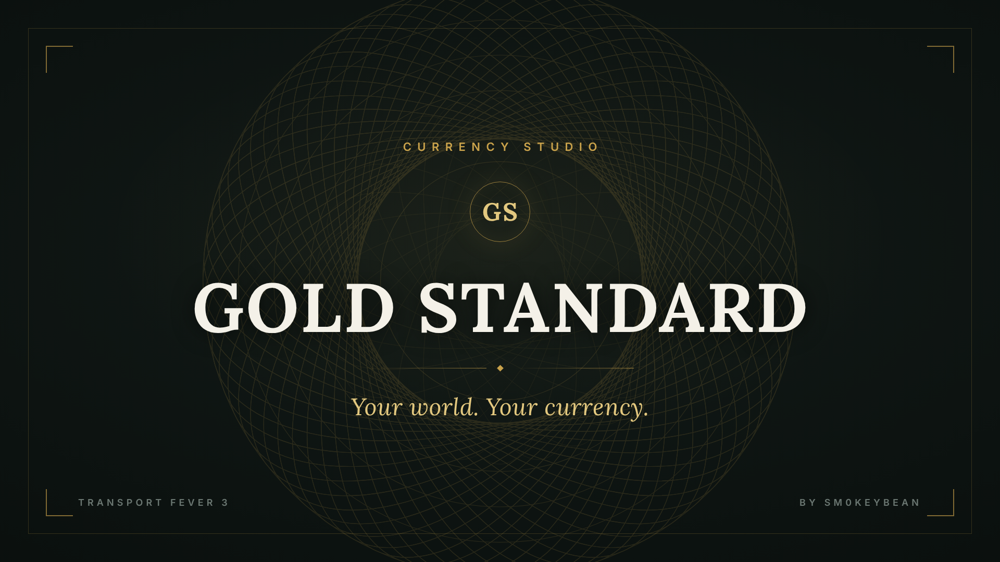

# Gold Standard: Currency Studio



**Your world. Your currency.**

Customize how money appears in Transport Fever 3. Choose a currency label, conversion rate, monetary base year, and annual display inflation or deflation, with live previews in Currency Studio.

**[Get Gold Standard on mod.io](https://mod.io/g/transportfever3/m/gold-standard-currency-studio)** · [Report a bug](https://github.com/sm0keybean/gold-standard/issues) · [Contribute](CONTRIBUTING.md)

Published November 1, 2026. Created by [sm0keybean](https://github.com/sm0keybean). Original code and documentation use the [MIT license](LICENSE).

## Features

- Editable currency presets and custom labels of 1–12 Unicode characters.
- Configurable conversion rate, base year, and annual display inflation/deflation.
- Decimal precision, grouping separators, prefix/suffix placement, and compact K/M/B amounts.
- Live previews, Apply, Cancel, and Reset Preview controls.
- Save-specific preferences retained when you save the game.
- Gold GS coin-seal toolbar button and Currency Studio panel.

## Install and use

1. Subscribe on [mod.io](https://mod.io/g/transportfever3/m/gold-standard-currency-studio), or locate the listing in TF3's Mod Hub.
2. Enable **Gold Standard: Currency Studio** for your game.
3. Open the gold **GS coin-seal button** in the mod toolbar.
4. Choose a preset or create a currency, then adjust the settings and live previews.
5. Select **Apply to this save**, then save your game to retain the settings.

For manual installation from this repository, copy only `fairl_gold_standard` into your TF3 user-data `local/mods` directory. The copied folder must directly contain `mod.json`. Do not copy the entire repository into the mods directory.

## Use any currency

Japanese yen is included as a preset. For Korean won, Russian ruble or another real or fictional denomination, choose **Create your own**, enter a label, and set your conversion rate. Examples: `¥` / `JPY`, `₩` / `KRW`, `₽` / `RUB`, florin `ƒ`, and franc `₣`.

Choose decimal places (including 0 for whole units), grouping separators, and whether the label appears before or after the amount. The base year and annual display rate apply to custom currencies as well as presets. If a symbol does not render in the game font, use its letter code instead.

Presets provide editable labels and formatting starting points, not live exchange rates, historical gold parities, or verified purchasing-power estimates. Major-currency preset rates start at 1:1. Greifenvauder Franken defaults to 0.25 per game dollar, base year 1900, and 2% annual display inflation.

## How the calendar affects money

Converted display amount = game amount × base rate × (1 + annual percent / 100)^(current game year − base year).

At a 0.25 base rate and 2% annual rate, an unchanged 1,000 game dollars displays as 250 currency units in 1900 and approximately 305 in 1910. This follows the in-game calendar, not time spent playing.

Gold Standard changes supported displays, not simulation balances, charges, prices or difficulty. The game's own economic adjustments continue independently. Historical finance rows use the current year's conversion, not each transaction's year. This is a denomination/display system rather than a simulation of central banks, gold reserves, or purchasing-power erosion.

## Compatibility and limitations

Panels using the shared Lua money-formatting functions can inherit Gold Standard's formatting. Other currency mods, custom formatters, and native displays may require integration; compatibility with every mod is not guaranteed.

- Native construction previews and floating numbers are not numerically converted. They use `game $` by default. The experimental native-label option changes the label only.
- The save-selection account preview remains in underlying game dollars.
- Sandbox/account inputs remain in game dollars.
- Some cached labels refresh only after reopening a panel or a related state change.
- Disabling requires a full game restart. Retained native currency-prefix settings may also need restoration.
- Long labels and high precision may exceed fixed-width fields supplied by other mods.
- Enhanced Vehicle Store uses a separate abbreviation function in its table. Without integration, a compact table price can retain the underlying game-dollar number while its label and detail view use Gold Standard. A matching currency label alone does not establish that a value was converted. Store updates can replace local compatibility changes; Gold Standard does not ship or maintain modified copies of other mods.

Developed and tested on Steam / Windows 64-bit, TF3 build 40425. Other platforms and builds have not been verified. Back up important saves before adding or updating mods.

## Development

Written in Lua using TF3's built-in GUI and scripting APIs, Lua stylesheet definitions, JSON metadata, and static seal images. Calculations, formatting, preferences, and interface code are separate modules. The mod adds no per-frame polling, timers, subscriptions, network access, or telemetry.

Install Python and Lupa (with Lua 5.4 support), then run `python tests/run_tests.py`. These are development dependencies, not player requirements. Automated checks cover validation, formatting, mocked persistence and lifecycle behavior; native rendering, serialization, compatibility, and long-session behavior also require in-game testing.

### Integrating narrow money fields

`runtime.narrowMoney(amount)` returns compact and full converted strings from the same settings/year snapshot. It preserves label, position, separators, and precision without changing ordinary formatting. Other mods must explicitly opt in; Gold Standard does not automatically rewrite their panels. Use the full string for a tooltip and the compact string for the narrow field.

Pass the original game-dollar amount exactly once. Do not abbreviate that raw number and attach a label extracted from a converted string: this changes the label without converting the number. Do not pass an already converted amount, which would apply conversion twice.

An optional integration can load the helper safely and retain the panel's existing formatter when Gold Standard is unavailable:

```lua
local ok, gs = pcall(ug_require, "fairl_gold_standard::/gold/runtime.lua")

local function narrowMoney(rawAmount)
    if ok and type(gs) == "table" and type(gs.narrowMoney) == "function" then
        local converted, short, full = pcall(gs.narrowMoney, rawAmount)
        if converted and type(short) == "string" and type(full) == "string" then
            return short, full -- cell text, full-value tooltip
        end
    end
    return existingMoneyFormatter(rawAmount) -- supplied by the integrating mod
end
```

Use this only for constrained money cells; leave roomy detail views on the normal shared money formatter. Check table, details, tooltip and purchase total for the same vehicle, including a value above 100,000 game dollars. Repeat after changing the conversion rate, annual rate, decimal separator and label position. Display integration must leave purchase calculations and affordability checks in game dollars.

## Community and support

Bug reports, improvements and translations are welcome. Include the game build, mod revision, settings, reproduction steps, and relevant screenshots or error excerpts in [GitHub Issues](https://github.com/sm0keybean/gold-standard/issues). Remove personal information before sharing diagnostics. See [CONTRIBUTING.md](CONTRIBUTING.md).

[Optional support on Ko-fi](https://ko-fi.com/smokeybean) is voluntary. All features remain free; donations do not unlock content.

Urban Games' shipped GUI and API definitions inform the integration. Third-party game resources and trademarks retain their respective ownership; MIT covers this project's original work. The game is required and is not included.
